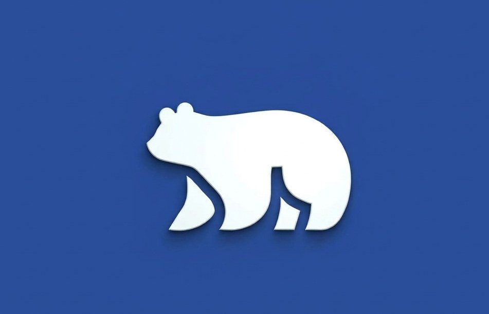
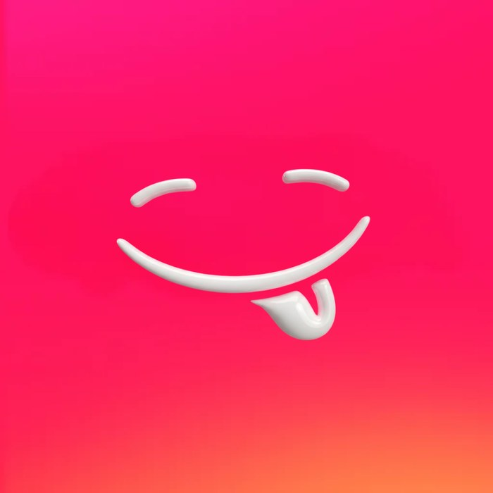

<!doctype html>
<html lang="es">
<head>
<meta charset="utf-8">
<meta name="viewport" content="width=device-width,initial-scale=1">
<title>Esneider de la Hoz · Melma Ice × Kannde</title>
<meta name="description" content="Portafolio de Esneider de la Hoz: creador de Melma Ice y Kannde.">

</head>
<body>

<canvas id="feathers"></canvas>
<main>
  <section class="hero">
    <h1>Esneider de la Hoz</h1>
    
Emprendedor y desarrollador front-end. Creo ecosistemas digitales y conceptos de hardware. Fundador de <b>Melma Ice</b> y <b>Kannde</b>.

    
✦ arrastra, lanza y choca los logos · toca para soltar plumas ✦

  </section>

  <section id="stage" aria-label="Mis empresas">
    

    

    
Melma Ice

    
Kannde

  </section>

  <section class="cards">
    <article class="card melma" id="melma">
      
Empresa 01

      <h2>Melma Ice 🐻‍❄️</h2>
      
Marca fría, sólida y con carácter. Identidad, producto y ecosistema digital en construcción.

    </article>
    <article class="card kannde" id="kannde">
      
Empresa 02

      <h2>Kannde 😋</h2>
      
Marca divertida, vibrante y con sabor. Experiencias digitales que se sienten vivas.

    </article>
  </section>

  <footer>
    <a href="https://github.com/nei08">GitHub</a>·<a href="mailto:delahozz027@gmail.com">Contacto</a>
  </footer>
</main>

</body>
</html>
