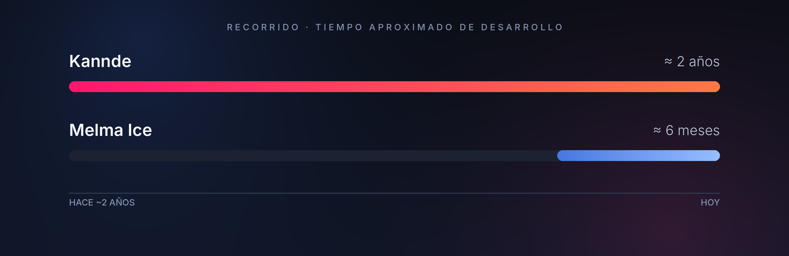

 

Soy Esneider, tengo 24 años y estoy construyendo mis propias empresas desde cero: 
aprendiendo, desarrollando ideas y convirtiéndolas en realidad. 
No espero a que las circunstancias sean perfectas para avanzar.

  

## Mis empresas

<table>
  <tr>
    <td align="center" width="50%">
      
    </td>
    <td align="center" width="50%">
      
    </td>
  </tr>
  <tr>
    <td align="center"><a href="https://melmaice.com/"><b>melmaice.com →</b></a></td>
    <td align="center">Sitio web · próximamente</td>
  </tr>
</table>

 

## Filosofía

Construir con constancia, aprender sobre la marcha y seguir adelante, 
con o sin tormenta.

 

## Recorrido

Dos proyectos en etapas distintas, construidos en paralelo.

  

## Tecnologías y herramientas

Próximamente.
<!-- Añade aquí tus tecnologías reales cuando las tengas definidas. -->

 

## Contacto

Enlaces profesionales · próximamente.
<!-- Ejemplo: [LinkedIn](https://...) · [Instagram](https://...) · [Correo](mailto:...) -->

 

Esneider De La Hoz · Melma Ice × Kannde

