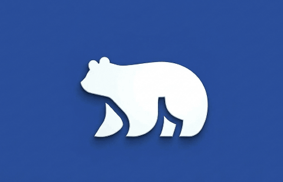
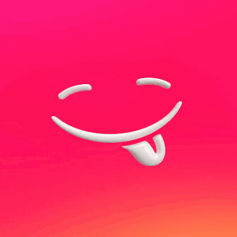

 

# Esneider De La Hoz
**Creador y fundador** · construyendo dos marcas desde cero

 

<table>
  <tr>
    <td align="center" width="50%" valign="top">
        
      <h3>Melma Ice</h3>
      EMPRESA 01 · PRIMER PROYECTO 
      Mi primera empresa, en construcción.  
      <a href="#"><kbd>&nbsp;Sitio web · próximamente&nbsp;</kbd></a>
    </td>
    <td align="center" width="50%" valign="top">
        
      <h3>Kannde</h3>
      EMPRESA 02 · SEGUNDO PROYECTO 
      Mi segunda empresa, en construcción.  
      <a href="#"><kbd>&nbsp;Sitio web · próximamente&nbsp;</kbd></a>
    </td>
  </tr>
</table>

 

## Sobre mí

Creo, desarrollo y construyo proyectos empresariales. Hoy tengo dos en marcha, **Melma Ice** y **Kannde**, y trabajo en ellos de forma directa: desde la identidad de marca hasta su presencia digital.

## Tecnologías y desarrollo

<!-- Pendiente: añade aquí tus tecnologías, herramientas y habilidades cuando las definas. -->
_Sección en preparación._

 

Esneider De La Hoz · Melma Ice × Kannde

